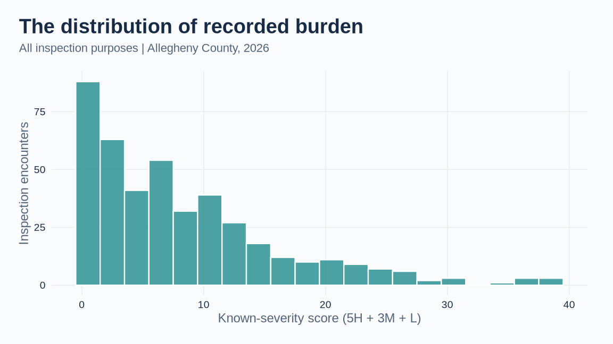
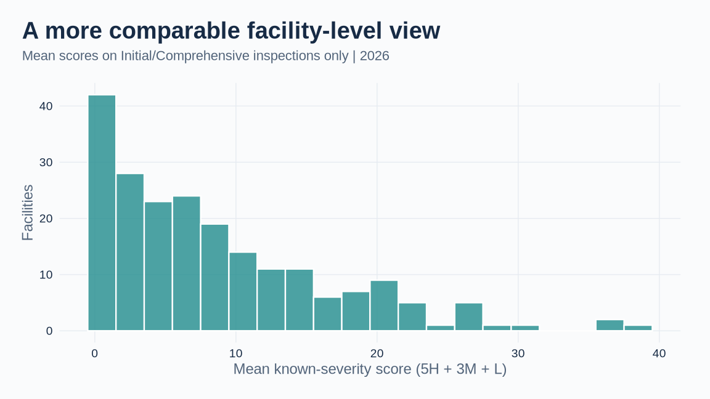
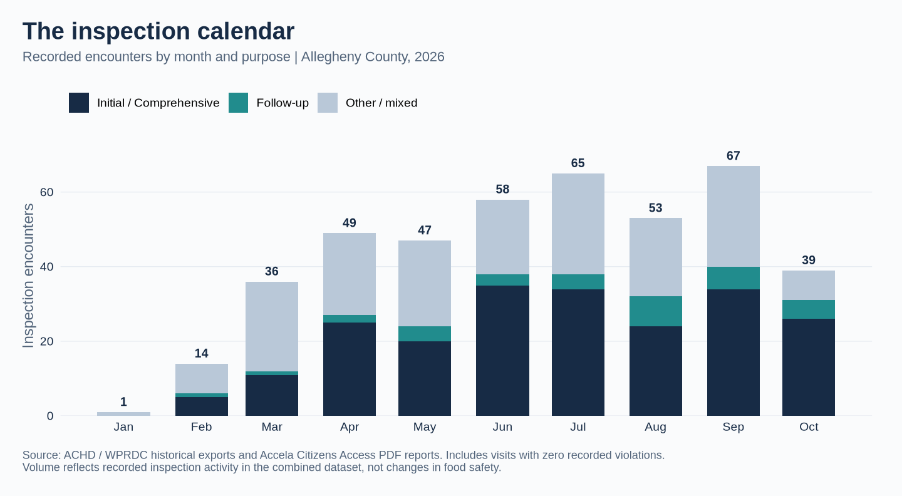
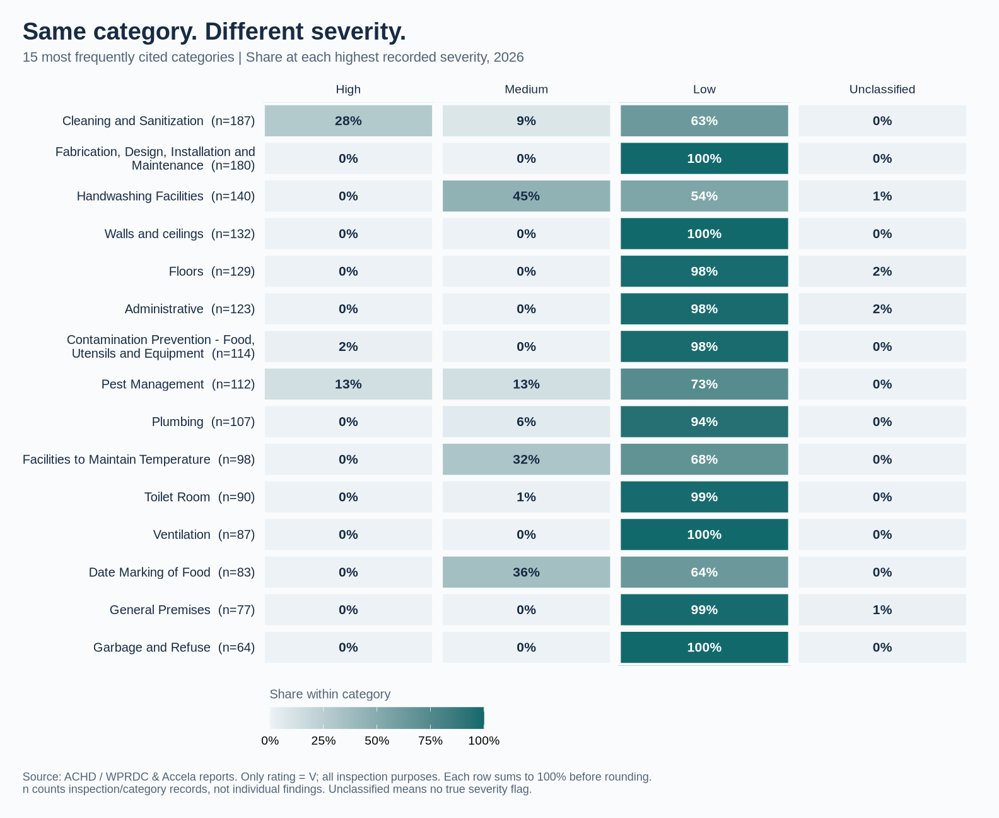
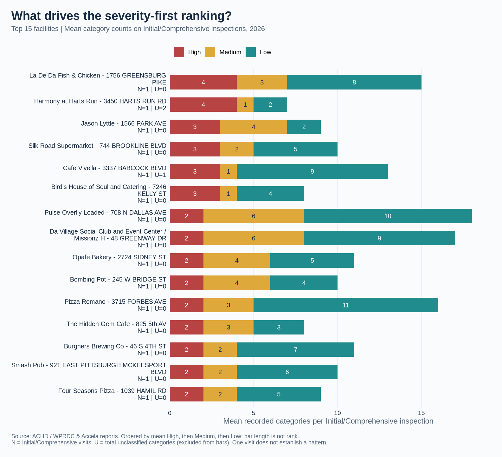
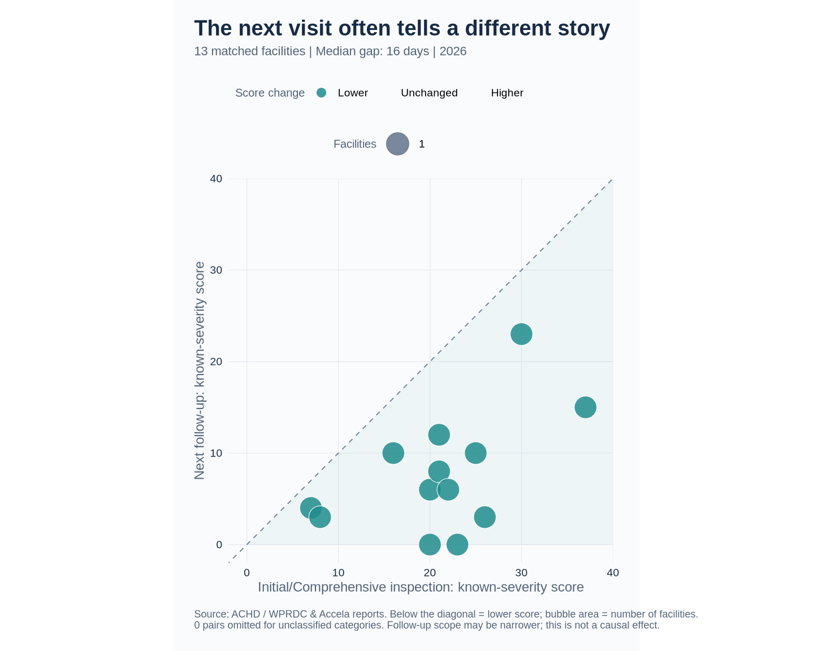

# Allegheny County Food Inspection Analysis 2026

Ranking Recorded Violations in the Available 2026 Accela Data

Mitchell Henschel

# Introduction

This analysis covers **Allegheny County**, not all of Western Pennsylvania. The combined local exports and scraped Accela PDF reports span 2014-01-02 through 2026-10-20. The 2026 results cover **2026-01-12 through 2026-10-20**, with 429 inspection encounters and 2,178 recorded violation-category rows extracted from PDF reports on the Accela Citizens Access portal. This is a partial-year analysis based on available PDF reports, not a complete 2026 ranking.

As a local data scientist, I wanted to make these public records easier to compare while preserving the severity information recorded by inspectors. This ranking is my analytical summary, not an official Health Department grade or an estimate of the probability of foodborne illness.

## What the Health Department's categories mean

The [Allegheny County Health Department (ACHD)](https://www.alleghenycounty.us/Services/Health-Department/Food-Safety/Search-Inspection-Reports) describes three severity levels:

| Severity | Meaning | Examples on ACHD's page |
|:---|:---|:---|
| High | Can directly lead to foodborne illness | Unsafe holding/cooking temperatures; improper employee handwashing |
| Medium | Can increase the chance of foodborne illness | No soap at handwashing sinks; no food probe thermometer; no Certified Food Protection Manager present |
| Low | Usually does not cause foodborne illness on its own; concerns cleanliness, safety, or maintenance | Damaged floors, poorly maintained ventilation hoods, poor lighting |

These are examples, not a fixed severity lookup for all findings in a category. The revised analysis uses the **`high`, `medium`, and `low` flags for each inspection/category** extracted from the inspection report table (including "Imminent" hazard marks under `high`), rather than guessing from `description_new`.

## Counting and ranking rules

1. **Only `rating = V` is a violation.** Other assessment rows are excluded even if severity flags remain populated.
2. **Count categories, not individual findings.** Each row is an inspection/category pair; one category can describe several problems. When multiple severity flags are true, assign that category its highest recorded severity (high, then medium, then low). Thus H, M, and L below are mutually exclusive category counts and may differ from the report's counts of all checked severity boxes.
3. **Keep unclassified violations visible.** A `V` row with no true severity flag is unclassified (U), not low risk or a zero-risk finding. H + M + L + U equals the number of violation categories. In this period, 10 categories are unclassified across 9 encounters. Rankings based on known severities may understate those encounters.
4. **Primary ranking: H, then M, then L, descending.** More high-severity categories rank ahead of any number of lower-severity categories. This is an explicit analytical choice to prioritize severity; ACHD does not prescribe this ordering of facilities. Identical H/M/L profiles share a rank. Dates and encounter IDs only stabilize display order; a top-20 display can cut a tie.
5. **Secondary score: 5H + 3M + L.** These are analyst-selected weights, not ACHD weights or measured risk ratios. The **known-severity score** omits unclassified categories and is incomplete wherever U > 0. It measures recorded category burden, not safety. No median or quartile is labeled a “clean” or “acceptable” threshold.

## Comparison population and data quality

- Link the inspection and violation exports by **`encounter`**, and group facilities by **`id`**. Names and street addresses are display labels, not identifiers. Separate encounters on the same date remain separate inspections.
- Include encounters from the inspection export even when there are no matching `V` rows. There are 53 such encounters in this period. “Zero recorded violations” is a database result, not proof that every condition was assessed or satisfactory.
- Compare facilities primarily using the mean H/M/L profile of routine visits whose purpose is **“Comprehensive”** (or **“Initial”**). Reinspections, complaints, pre-operational visits, and change-of-ownership encounters can have different scopes. All-encounter averages remain descriptive context. Even routine visits are not a random or fully standardized sample, and facilities with one visit have limited evidence.
- Exclude explicit training-client names by facility ID and export the exclusion list for review. Duplicate encounter/category rows, invalid severity flags, and unmatched inspection metadata stop processing instead of silently changing rankings.

ACHD changed software on **August 11, 2025**; 2026 reports are published as PDF attachments through [Citizens Access](https://aca-prod.accela.com/ALLEGHENYCO/Cap/CapHome.aspx?module=EnvHealth&TabName=Home) and extracted via `scraper/scrape_pdfs.py`. Report links and inspection placards describe those visits, not a facility's current status.

# Stats for Nerds

Distribution of known-severity scores for all recorded inspection encounters in the available 2026 period, including zero-recorded-violation visits:

<!-- -->

Table: Known-severity score summary (all purposes)

|Statistic | Score|
|:---------|-----:|
|Min       |  0.00|
|Q1        |  2.00|
|Median    |  6.00|
|Mean      |  8.28|
|Q3        | 12.00|
|Max       | 38.00|

For facility comparisons, use only Initial/Comprehensive inspections and retain zero-recorded-violation visits in the denominator. This distribution gives each facility one observation: its mean known-severity score over its Initial/Comprehensive inspections in the available period.

<!-- -->

Table: Facility mean score summary (Initial/Comprehensive inspections only)

|Statistic | Score|
|:---------|-----:|
|Min       |  0.00|
|Q1        |  2.00|
|Median    |  7.00|
|Mean      |  8.62|
|Q3        | 12.75|
|Max       | 38.00|

## Sensitivity to the ranking method

The severity-first and 5/3/1 weighted top-20 inspection lists share **16 of 20** encounters. Changing the weights to 3/2/1 retains **16 of 20** encounters from the 5/3/1 list. These are descriptive sensitivity checks with deterministic tie-breaking, not statistical confidence measures. The main severity-first ranking does not depend on numerical weights.

# A Visual Tour of the Findings

The HTML report adds hover details, zoom controls, and clickable follow-up bubbles. Render it with `quarto render 2026_hall_of_shame.qmd --to html` and open `2026_Health_Inspections_Interactive.html` in a browser. GitHub's README preview and the PDF use static images. The HTML file is self-contained and can be shared or hosted as a portfolio page.

## Inspection activity and scope

Inspection volume and purpose provide context for the rankings. The chart counts every recorded encounter, including visits with no recorded violations. “Follow-up” includes the exact purposes Reinspection and Partial ReInspection; mixed-purpose and pre-operational/ownership-change visits are grouped with other visits. These monthly counts describe activity in the scraped PDF dataset, not a trend in restaurant safety.

## Why category names alone cannot determine severity

Each row below shows the severity mix within one of the 15 most frequently cited categories. A darker cell means a larger share of that category's violation records, not a more dangerous category. The variation is why this analysis uses the inspector's recorded flags instead of assigning every occurrence of a category the same severity.

## The composition behind the ranking

The bars below show the mean number of categories at each severity for the top 15 facilities in the Initial/Comprehensive ranking. Facilities are ordered by their severity profile, not by total bar length. The annotations retain the inspection denominator and the number of unclassified categories so the limits of each comparison remain visible.

## What happens at the next recorded follow-up?

Match an Initial/Comprehensive visit to the very next recorded encounter for the same facility only when that encounter is a Reinspection or Partial ReInspection on a later date. Keep the earliest eligible pair per facility within the available 2026 period, then exclude pairs with unclassified categories at either visit. This is chronological matching, not a verified administrative link between reports. Same-day pairs are excluded because the analysis does not use visit times.

Below the diagonal, the follow-up score is lower than the Initial score. Bubble area represents the number of facilities at the same coordinates. These facilities are a selected group that received follow-up visits; changes can reflect both corrections and narrower follow-up scope.

In the HTML version, **hover over a bubble to preview restaurant names; click it to see every facility at that coordinate**, including both visit dates, scores, and report links. The dropdown below the chart also lets you select a facility using a keyboard or touch screen. Accela search links are labeled as searches and include the encounter identifier.

# 2026 Rankings: Available Accela Period

Click a facility name for the linked portal. **H/M/L** are category counts at the highest recorded severity; **U** is the number of unclassified categories. The tables describe recorded conditions during this period, not current operating conditions.

## Inspections ranked by recorded severity

Table: Top 20 inspection encounters by H, then M, then L

|Facility                                                                          | Rank|Date       |Purpose                    |  H|  M|  L|  U|
|:---------------------------------------------------------------------------------|----:|:----------|:--------------------------|--:|--:|--:|--:|
|[Mad Noodles - 2017 E CARSON ST, Pittsburgh](https://aca-prod.accela.com/ALLEGHENYCO/Cap/CapHome.aspx?module=EnvHealth&TabName=Home)|    1|2026-09-22 |Pre-Operational Inspection |  4|  3|  8|  0|
|[La De Da Fish & Chicken - 1756 GREENSBURG PIKE, North Versailles](https://aca-prod.accela.com/ALLEGHENYCO/Cap/CapHome.aspx?module=EnvHealth&TabName=Home)|    1|2026-06-22 |Comprehensive              |  4|  3|  8|  0|
|[Harmony at Harts Run - 3450 HARTS RUN RD, Glenshaw](https://aca-prod.accela.com/ALLEGHENYCO/Cap/CapHome.aspx?module=EnvHealth&TabName=Home)|    3|2026-07-15 |Comprehensive              |  4|  1|  2|  2|
|[Mad Noodles - 2017 E CARSON ST, Pittsburgh](https://aca-prod.accela.com/ALLEGHENYCO/Cap/CapHome.aspx?module=EnvHealth&TabName=Home)|    4|2026-04-28 |Change of Ownership        |  3|  5|  8|  0|
|[Cafe 33 - 1711 SHADY AVE, Pittsburgh](https://aca-prod.accela.com/ALLEGHENYCO/Cap/CapHome.aspx?module=EnvHealth&TabName=Home)|    5|2026-07-31 |Pre-Operational Inspection |  3|  4| 11|  0|
|[Jason Lyttle - 1566 PARK AVE, Pittsburgh](https://aca-prod.accela.com/ALLEGHENYCO/Cap/CapHome.aspx?module=EnvHealth&TabName=Home)|    6|2026-08-10 |Comprehensive              |  3|  4|  2|  0|
|[Silk Road Supermarket - 744 BROOKLINE BLVD, Pittsburgh](https://aca-prod.accela.com/ALLEGHENYCO/Cap/CapHome.aspx?module=EnvHealth&TabName=Home)|    7|2026-08-18 |Comprehensive              |  3|  2|  5|  0|
|[Cafe Vivella - 3337 BABCOCK BLVD, Pittsburgh](https://aca-prod.accela.com/ALLEGHENYCO/Cap/CapHome.aspx?module=EnvHealth&TabName=Home)|    8|2026-08-11 |Comprehensive              |  3|  1|  9|  1|
|[Bird's House of Soul and Catering - 7246 KELLY ST, Pittsburgh](https://aca-prod.accela.com/ALLEGHENYCO/Cap/CapHome.aspx?module=EnvHealth&TabName=Home)|    9|2026-09-03 |Comprehensive              |  3|  1|  4|  0|
|[Champion City Nursing & Rehabilitation Center - 6655 FRANKSTOWN AVE, Pittsburgh](https://aca-prod.accela.com/ALLEGHENYCO/Cap/CapHome.aspx?module=EnvHealth&TabName=Home)|    9|2026-07-29 |Change of Ownership        |  3|  1|  4|  0|
|[Hanini Market / Hanini Subs - 1105 Franklin AV, Pittsburgh](https://aca-prod.accela.com/ALLEGHENYCO/Cap/CapHome.aspx?module=EnvHealth&TabName=Home)|   11|2026-09-14 |Change of Ownership        |  3|  0| 11|  1|
|[Pulse Overlly Loaded - 708 N DALLAS AVE, Pittsburgh](https://aca-prod.accela.com/ALLEGHENYCO/Cap/CapHome.aspx?module=EnvHealth&TabName=Home)|   12|2026-08-05 |Comprehensive              |  2|  6| 10|  0|
|[Da Village Social Club and Event Center / Missionz H - 48 GREENWAY DR, Pittsburgh](https://aca-prod.accela.com/ALLEGHENYCO/Cap/CapHome.aspx?module=EnvHealth&TabName=Home)|   13|2026-03-17 |Comprehensive              |  2|  6|  9|  0|
|[Chaai & Chaatwala - 4613 Centre AV, Pittsburgh](https://aca-prod.accela.com/ALLEGHENYCO/Cap/CapHome.aspx?module=EnvHealth&TabName=Home)|   14|2026-08-18 |Change of Ownership        |  2|  5| 10|  0|
|[Opafe Bakery - 2724 SIDNEY ST, Pittsburgh](https://aca-prod.accela.com/ALLEGHENYCO/Cap/CapHome.aspx?module=EnvHealth&TabName=Home)|   15|2026-10-19 |Comprehensive              |  2|  4|  5|  0|
|[Bombing Pot - 245 W BRIDGE ST, Homestead](https://aca-prod.accela.com/ALLEGHENYCO/Cap/CapHome.aspx?module=EnvHealth&TabName=Home)|   16|2026-09-23 |Comprehensive              |  2|  4|  4|  0|
|[Vinny ’ s Pizza, Hoagies, and Wings - 618 BROOKLINE BLVD, Pittsburgh](https://aca-prod.accela.com/ALLEGHENYCO/Cap/CapHome.aspx?module=EnvHealth&TabName=Home)|   17|2026-06-11 |Change of Ownership        |  2|  3| 11|  0|
|[Pizza Romano - 3715 FORBES AVE, Pittsburgh](https://aca-prod.accela.com/ALLEGHENYCO/Cap/CapHome.aspx?module=EnvHealth&TabName=Home)|   17|2026-04-29 |Comprehensive              |  2|  3| 11|  0|
|[The Hidden Gem Cafe - 825 5th AV, East Mc Keesport](https://aca-prod.accela.com/ALLEGHENYCO/Cap/CapHome.aspx?module=EnvHealth&TabName=Home)|   19|2026-07-14 |Comprehensive              |  2|  3|  3|  0|
|[Wiggys Restaurant - 2350 NOBLESTOWN RD STE 138, Pittsburgh](https://aca-prod.accela.com/ALLEGHENYCO/Cap/CapHome.aspx?module=EnvHealth&TabName=Home)|   20|2026-08-03 |Change of Ownership        |  2|  2|  8|  0|

## Secondary view: weighted category burden

This list allows several lower-severity categories to outweigh a higher-severity category. It answers a different question from the main ranking. The score is incomplete when U > 0.

Table: Top 20 encounters by known-severity score (5H + 3M + L)

|Facility                                                                          |Date       |Purpose                    | Score|  H|  M|  L|  U|
|:---------------------------------------------------------------------------------|:----------|:--------------------------|-----:|--:|--:|--:|--:|
|[Pulse Overlly Loaded - 708 N DALLAS AVE, Pittsburgh](https://aca-prod.accela.com/ALLEGHENYCO/Cap/CapHome.aspx?module=EnvHealth&TabName=Home)|2026-08-05 |Comprehensive              |    38|  2|  6| 10|  0|
|[Cafe 33 - 1711 SHADY AVE, Pittsburgh](https://aca-prod.accela.com/ALLEGHENYCO/Cap/CapHome.aspx?module=EnvHealth&TabName=Home)|2026-07-31 |Pre-Operational Inspection |    38|  3|  4| 11|  0|
|[Mad Noodles - 2017 E CARSON ST, Pittsburgh](https://aca-prod.accela.com/ALLEGHENYCO/Cap/CapHome.aspx?module=EnvHealth&TabName=Home)|2026-04-28 |Change of Ownership        |    38|  3|  5|  8|  0|
|[Mad Noodles - 2017 E CARSON ST, Pittsburgh](https://aca-prod.accela.com/ALLEGHENYCO/Cap/CapHome.aspx?module=EnvHealth&TabName=Home)|2026-09-22 |Pre-Operational Inspection |    37|  4|  3|  8|  0|
|[La De Da Fish & Chicken - 1756 GREENSBURG PIKE, North Versailles](https://aca-prod.accela.com/ALLEGHENYCO/Cap/CapHome.aspx?module=EnvHealth&TabName=Home)|2026-06-22 |Comprehensive              |    37|  4|  3|  8|  0|
|[Da Village Social Club and Event Center / Missionz H - 48 GREENWAY DR, Pittsburgh](https://aca-prod.accela.com/ALLEGHENYCO/Cap/CapHome.aspx?module=EnvHealth&TabName=Home)|2026-03-17 |Comprehensive              |    37|  2|  6|  9|  0|
|[Chaai & Chaatwala - 4613 Centre AV, Pittsburgh](https://aca-prod.accela.com/ALLEGHENYCO/Cap/CapHome.aspx?module=EnvHealth&TabName=Home)|2026-08-18 |Change of Ownership        |    35|  2|  5| 10|  0|
|[Piyola - 663 Washington RD, Pittsburgh](https://aca-prod.accela.com/ALLEGHENYCO/Cap/CapHome.aspx?module=EnvHealth&TabName=Home)|2026-08-04 |Change of Ownership        |    31|  1|  5| 11|  0|
|[Vinny ’ s Pizza, Hoagies, and Wings - 618 BROOKLINE BLVD, Pittsburgh](https://aca-prod.accela.com/ALLEGHENYCO/Cap/CapHome.aspx?module=EnvHealth&TabName=Home)|2026-06-11 |Change of Ownership        |    30|  2|  3| 11|  0|
|[Pizza Romano - 3715 FORBES AVE, Pittsburgh](https://aca-prod.accela.com/ALLEGHENYCO/Cap/CapHome.aspx?module=EnvHealth&TabName=Home)|2026-04-29 |Comprehensive              |    30|  2|  3| 11|  0|
|[Fox's Pizza Penn Hills - 12244 Frankstown RD, Pittsburgh](https://aca-prod.accela.com/ALLEGHENYCO/Cap/CapHome.aspx?module=EnvHealth&TabName=Home)|2026-08-27 |Change of Ownership        |    29|  0|  7|  8|  0|
|[Jason Lyttle - 1566 PARK AVE, Pittsburgh](https://aca-prod.accela.com/ALLEGHENYCO/Cap/CapHome.aspx?module=EnvHealth&TabName=Home)|2026-08-10 |Comprehensive              |    29|  3|  4|  2|  0|
|[Opafe Bakery - 2724 SIDNEY ST, Pittsburgh](https://aca-prod.accela.com/ALLEGHENYCO/Cap/CapHome.aspx?module=EnvHealth&TabName=Home)|2026-10-19 |Comprehensive              |    27|  2|  4|  5|  0|
|[Cafe Vivella - 3337 BABCOCK BLVD, Pittsburgh](https://aca-prod.accela.com/ALLEGHENYCO/Cap/CapHome.aspx?module=EnvHealth&TabName=Home)|2026-08-11 |Comprehensive              |    27|  3|  1|  9|  1|
|[Bombing Pot - 245 W BRIDGE ST, Homestead](https://aca-prod.accela.com/ALLEGHENYCO/Cap/CapHome.aspx?module=EnvHealth&TabName=Home)|2026-09-23 |Comprehensive              |    26|  2|  4|  4|  0|
|[Hanini Market / Hanini Subs - 1105 Franklin AV, Pittsburgh](https://aca-prod.accela.com/ALLEGHENYCO/Cap/CapHome.aspx?module=EnvHealth&TabName=Home)|2026-09-14 |Change of Ownership        |    26|  3|  0| 11|  1|
|[Silk Road Supermarket - 744 BROOKLINE BLVD, Pittsburgh](https://aca-prod.accela.com/ALLEGHENYCO/Cap/CapHome.aspx?module=EnvHealth&TabName=Home)|2026-08-18 |Comprehensive              |    26|  3|  2|  5|  0|
|[Steel Town Tavern - 1720 MURRAY AVE, Pittsburgh](https://aca-prod.accela.com/ALLEGHENYCO/Cap/CapHome.aspx?module=EnvHealth&TabName=Home)|2026-05-19 |Comprehensive              |    26|  0|  5| 11|  0|
|[Harmony at Harts Run - 3450 HARTS RUN RD, Glenshaw](https://aca-prod.accela.com/ALLEGHENYCO/Cap/CapHome.aspx?module=EnvHealth&TabName=Home)|2026-07-15 |Comprehensive              |    25|  4|  1|  2|  2|
|[Cafe TU Y YO - Sewickley - 443 DIVISION ST, Sewickley](https://aca-prod.accela.com/ALLEGHENYCO/Cap/CapHome.aspx?module=EnvHealth&TabName=Home)|2026-04-01 |Comprehensive              |    25|  1|  4|  8|  0|

## Facilities ranked using Initial/Comprehensive inspections

Order facilities by mean H, then mean M, then mean L across Initial/Comprehensive inspections only. **N** is the number of those inspections; **U** is their total unclassified category count. A high mean based on N = 1 does not establish a pattern of repeated problems. Links go to each facility's latest recorded encounter in the period, which may be a reinspection rather than an Initial visit.

Table: Top 20 facilities by mean Initial/Comprehensive-inspection severity profile

|Facility                                                                          | Rank|  N| Mean H| Mean M| Mean L|  U|
|:---------------------------------------------------------------------------------|----:|--:|------:|------:|------:|--:|
|[La De Da Fish & Chicken - 1756 GREENSBURG PIKE, North Versailles](https://aca-prod.accela.com/ALLEGHENYCO/Cap/CapHome.aspx?module=EnvHealth&TabName=Home)|    1|  1|      4|      3|      8|  0|
|[Harmony at Harts Run - 3450 HARTS RUN RD, Glenshaw](https://aca-prod.accela.com/ALLEGHENYCO/Cap/CapHome.aspx?module=EnvHealth&TabName=Home)|    2|  1|      4|      1|      2|  2|
|[Jason Lyttle - 1566 PARK AVE, Pittsburgh](https://aca-prod.accela.com/ALLEGHENYCO/Cap/CapHome.aspx?module=EnvHealth&TabName=Home)|    3|  1|      3|      4|      2|  0|
|[Silk Road Supermarket - 744 BROOKLINE BLVD, Pittsburgh](https://aca-prod.accela.com/ALLEGHENYCO/Cap/CapHome.aspx?module=EnvHealth&TabName=Home)|    4|  1|      3|      2|      5|  0|
|[Cafe Vivella - 3337 BABCOCK BLVD, Pittsburgh](https://aca-prod.accela.com/ALLEGHENYCO/Cap/CapHome.aspx?module=EnvHealth&TabName=Home)|    5|  1|      3|      1|      9|  1|
|[Bird's House of Soul and Catering - 7246 KELLY ST, Pittsburgh](https://aca-prod.accela.com/ALLEGHENYCO/Cap/CapHome.aspx?module=EnvHealth&TabName=Home)|    6|  1|      3|      1|      4|  0|
|[Pulse Overlly Loaded - 708 N DALLAS AVE, Pittsburgh](https://aca-prod.accela.com/ALLEGHENYCO/Cap/CapHome.aspx?module=EnvHealth&TabName=Home)|    7|  1|      2|      6|     10|  0|
|[Da Village Social Club and Event Center / Missionz H - 48 GREENWAY DR, Pittsburgh](https://aca-prod.accela.com/ALLEGHENYCO/Cap/CapHome.aspx?module=EnvHealth&TabName=Home)|    8|  1|      2|      6|      9|  0|
|[Opafe Bakery - 2724 SIDNEY ST, Pittsburgh](https://aca-prod.accela.com/ALLEGHENYCO/Cap/CapHome.aspx?module=EnvHealth&TabName=Home)|    9|  1|      2|      4|      5|  0|
|[Bombing Pot - 245 W BRIDGE ST, Homestead](https://aca-prod.accela.com/ALLEGHENYCO/Cap/CapHome.aspx?module=EnvHealth&TabName=Home)|   10|  1|      2|      4|      4|  0|
|[Pizza Romano - 3715 FORBES AVE, Pittsburgh](https://aca-prod.accela.com/ALLEGHENYCO/Cap/CapHome.aspx?module=EnvHealth&TabName=Home)|   11|  1|      2|      3|     11|  0|
|[The Hidden Gem Cafe - 825 5th AV, East Mc Keesport](https://aca-prod.accela.com/ALLEGHENYCO/Cap/CapHome.aspx?module=EnvHealth&TabName=Home)|   12|  1|      2|      3|      3|  0|
|[Burghers Brewing Co - 46 S 4TH ST, Pittsburgh](https://aca-prod.accela.com/ALLEGHENYCO/Cap/CapHome.aspx?module=EnvHealth&TabName=Home)|   13|  1|      2|      2|      7|  0|
|[Smash Pub - 921 EAST PITTSBURGH MCKEESPORT BLVD, North Versailles](https://aca-prod.accela.com/ALLEGHENYCO/Cap/CapHome.aspx?module=EnvHealth&TabName=Home)|   14|  1|      2|      2|      6|  0|
|[Four Seasons Pizza - 1039 HAMIL RD, Verona](https://aca-prod.accela.com/ALLEGHENYCO/Cap/CapHome.aspx?module=EnvHealth&TabName=Home)|   15|  1|      2|      2|      5|  0|
|[Sugarbird - 151 MAZEROSKI WAY, Pittsburgh](https://aca-prod.accela.com/ALLEGHENYCO/Cap/CapHome.aspx?module=EnvHealth&TabName=Home)|   16|  1|      2|      2|      4|  0|
|[China House - 4506 LIBERTY AVE, Pittsburgh](https://aca-prod.accela.com/ALLEGHENYCO/Cap/CapHome.aspx?module=EnvHealth&TabName=Home)|   17|  1|      2|      1|     10|  0|
|[Big Shot Bobs House of Wings - 5336 PERRY HWY, Pittsburgh](https://aca-prod.accela.com/ALLEGHENYCO/Cap/CapHome.aspx?module=EnvHealth&TabName=Home)|   18|  1|      2|      1|      8|  0|
|[Dragon City - 503 LINCOLN AVE, Pittsburgh](https://aca-prod.accela.com/ALLEGHENYCO/Cap/CapHome.aspx?module=EnvHealth&TabName=Home)|   19|  1|      2|      1|      6|  0|
|[Lamperts Market - 2010 EDEN PARK BLVD, Mckeesport](https://aca-prod.accela.com/ALLEGHENYCO/Cap/CapHome.aspx?module=EnvHealth&TabName=Home)|   19|  1|      2|      1|      6|  0|

## Follow-up context for those facilities

For the same facilities, **N** counts all encounter purposes and **Mean** is the all-encounter mean known-severity score, including zero-recorded-violation visits. **Latest** is the score for the linked encounter; **U** is its unclassified category count. The mean also omits unclassified categories on earlier visits; their totals are retained in the CSV. A lower follow-up score can reflect corrections or a narrower inspection scope, so it does not prove that all previous problems were resolved.

Table: All-encounter and latest-visit context for the facilities above

|Facility                                                                          |  N|  Mean|Date       |Purpose               | Latest|  U|
|:---------------------------------------------------------------------------------|--:|-----:|:----------|:---------------------|------:|--:|
|[La De Da Fish & Chicken - 1756 GREENSBURG PIKE, North Versailles](https://aca-prod.accela.com/ALLEGHENYCO/Cap/CapHome.aspx?module=EnvHealth&TabName=Home)|  5| 13.00|2026-09-22 |Administrative Action |      0|  0|
|[Harmony at Harts Run - 3450 HARTS RUN RD, Glenshaw](https://aca-prod.accela.com/ALLEGHENYCO/Cap/CapHome.aspx?module=EnvHealth&TabName=Home)|  1| 25.00|2026-07-15 |Comprehensive         |     25|  2|
|[Jason Lyttle - 1566 PARK AVE, Pittsburgh](https://aca-prod.accela.com/ALLEGHENYCO/Cap/CapHome.aspx?module=EnvHealth&TabName=Home)|  1| 29.00|2026-08-10 |Comprehensive         |     29|  0|
|[Silk Road Supermarket - 744 BROOKLINE BLVD, Pittsburgh](https://aca-prod.accela.com/ALLEGHENYCO/Cap/CapHome.aspx?module=EnvHealth&TabName=Home)|  2| 19.00|2026-08-18 |Comprehensive         |     26|  0|
|[Cafe Vivella - 3337 BABCOCK BLVD, Pittsburgh](https://aca-prod.accela.com/ALLEGHENYCO/Cap/CapHome.aspx?module=EnvHealth&TabName=Home)|  1| 27.00|2026-08-11 |Comprehensive         |     27|  1|
|[Bird's House of Soul and Catering - 7246 KELLY ST, Pittsburgh](https://aca-prod.accela.com/ALLEGHENYCO/Cap/CapHome.aspx?module=EnvHealth&TabName=Home)|  2| 14.00|2026-09-28 |Reinspection          |      6|  0|
|[Pulse Overlly Loaded - 708 N DALLAS AVE, Pittsburgh](https://aca-prod.accela.com/ALLEGHENYCO/Cap/CapHome.aspx?module=EnvHealth&TabName=Home)|  1| 38.00|2026-08-05 |Comprehensive         |     38|  0|
|[Da Village Social Club and Event Center / Missionz H - 48 GREENWAY DR, Pittsburgh](https://aca-prod.accela.com/ALLEGHENYCO/Cap/CapHome.aspx?module=EnvHealth&TabName=Home)|  1| 37.00|2026-03-17 |Comprehensive         |     37|  0|
|[Opafe Bakery - 2724 SIDNEY ST, Pittsburgh](https://aca-prod.accela.com/ALLEGHENYCO/Cap/CapHome.aspx?module=EnvHealth&TabName=Home)|  1| 27.00|2026-10-19 |Comprehensive         |     27|  0|
|[Bombing Pot - 245 W BRIDGE ST, Homestead](https://aca-prod.accela.com/ALLEGHENYCO/Cap/CapHome.aspx?module=EnvHealth&TabName=Home)|  3| 11.33|2026-09-29 |Reinspection          |      3|  0|
|[Pizza Romano - 3715 FORBES AVE, Pittsburgh](https://aca-prod.accela.com/ALLEGHENYCO/Cap/CapHome.aspx?module=EnvHealth&TabName=Home)|  2| 26.50|2026-05-15 |Reinspection          |     23|  0|
|[The Hidden Gem Cafe - 825 5th AV, East Mc Keesport](https://aca-prod.accela.com/ALLEGHENYCO/Cap/CapHome.aspx?module=EnvHealth&TabName=Home)|  2| 11.00|2026-07-14 |Comprehensive         |     22|  0|
|[Burghers Brewing Co - 46 S 4TH ST, Pittsburgh](https://aca-prod.accela.com/ALLEGHENYCO/Cap/CapHome.aspx?module=EnvHealth&TabName=Home)|  2| 16.50|2026-05-22 |Comprehensive         |     23|  0|
|[Smash Pub - 921 EAST PITTSBURGH MCKEESPORT BLVD, North Versailles](https://aca-prod.accela.com/ALLEGHENYCO/Cap/CapHome.aspx?module=EnvHealth&TabName=Home)|  3|  9.67|2026-07-22 |Comprehensive         |     22|  0|
|[Four Seasons Pizza - 1039 HAMIL RD, Verona](https://aca-prod.accela.com/ALLEGHENYCO/Cap/CapHome.aspx?module=EnvHealth&TabName=Home)|  4| 10.00|2026-06-01 |Reinspection          |      8|  0|
|[Sugarbird - 151 MAZEROSKI WAY, Pittsburgh](https://aca-prod.accela.com/ALLEGHENYCO/Cap/CapHome.aspx?module=EnvHealth&TabName=Home)|  2| 11.50|2026-05-22 |Comprehensive         |     20|  0|
|[China House - 4506 LIBERTY AVE, Pittsburgh](https://aca-prod.accela.com/ALLEGHENYCO/Cap/CapHome.aspx?module=EnvHealth&TabName=Home)|  2| 11.50|2026-03-25 |Reinspection          |      0|  0|
|[Big Shot Bobs House of Wings - 5336 PERRY HWY, Pittsburgh](https://aca-prod.accela.com/ALLEGHENYCO/Cap/CapHome.aspx?module=EnvHealth&TabName=Home)|  3| 14.00|2026-07-20 |Reinspection          |     12|  0|
|[Dragon City - 503 LINCOLN AVE, Pittsburgh](https://aca-prod.accela.com/ALLEGHENYCO/Cap/CapHome.aspx?module=EnvHealth&TabName=Home)|  2| 13.00|2026-06-04 |Comprehensive         |     19|  0|
|[Lamperts Market - 2010 EDEN PARK BLVD, Mckeesport](https://aca-prod.accela.com/ALLEGHENYCO/Cap/CapHome.aspx?module=EnvHealth&TabName=Home)|  4|  8.50|2026-10-02 |Partial ReInspection  |      0|  0|

---

Health inspections are a snapshot of how a food facility is operating at a specific point in time, not a permanent verdict. Severity, inspection scope, and follow-up findings matter more than a single league-table position. Read the full report and check recent inspections before drawing conclusions about a facility today.

Questions and suggestions on my methodology are welcome. Thanks for reading!

[Source code](https://github.com/Elkip/West-PA-Health-Inspection-Analysis/tree/master)

# Reproducing the Analysis

Interactive HTML additionally requires `plotly`, `htmlwidgets`, and `htmltools`: install them with `install.packages(c("plotly", "htmlwidgets", "htmltools"))`. With Quarto installed, run `quarto render 2026_hall_of_shame.qmd --to html`. The generated HTML embeds its JavaScript and works offline; opening the linked inspection reports requires internet access.

Use R 4.1 or later with `dplyr` (1.1.0 or later), `tidyr`, `ggplot2`, `stringr`, `scales`, and `knitr`. Packages must be built for a compatible version of R. From the repository root:

1. Save the [historical violation export](https://data.wprdc.org/datastore/dump/1a1329e2-418c-4bd3-af2c-cc334e7559af) as `data/wprdc_violations.csv` and the matching [historical inspection export](https://data.wprdc.org/datastore/dump/4ea730d8-2bf9-4783-b0a5-b41ed687097e) as `data/wprdc_inspections.csv`, then run `python3 scraper/scrape_pdfs.py --combine` to extract the Accela PDF reports (`data/accela_inspections.csv` and `data/accela_violations.csv`) and merge both sources into `data/inspections.csv` and `data/violations.csv`.
2. Run `Rscript clean_inspections.r` to generate the summaries in `out/`.
3. Run `Rscript tests/test_inspection_analysis.R` to check scoring and aggregation, including two comparisons with original inspection PDFs when the local exports are available. Run `Rscript tests/test_followup_matching.R` to check the follow-up chart's matching rules.
4. Run `Rscript render_readme.r` to regenerate `README.md` (and `2026_README.md`) and plots from the Quarto documents. For a PDF, install Quarto and a TeX distribution and run `quarto render 2026_hall_of_shame.qmd --to pdf`.

Generated files:

- `out/violations_by_inspection.csv`: all encounters in the shared export window, purpose, severity counts, unclassified counts, known-severity score, and `SCORE_COMPLETE` (whether every recorded violation category has a severity).
- `out/violations_by_year.csv`: facility/year summaries, Initial/Comprehensive-only and all-encounter means, denominators, and latest-report context within each year.
- `out/category_severity_audit.csv`: recorded severity distribution by category and year across the shared window; the visualizations use only 2026.
- `out/coverage.csv`: date bounds and record counts after training-client exclusions.
- `out/excluded_training_facilities.csv`: excluded facility identifiers and names.
