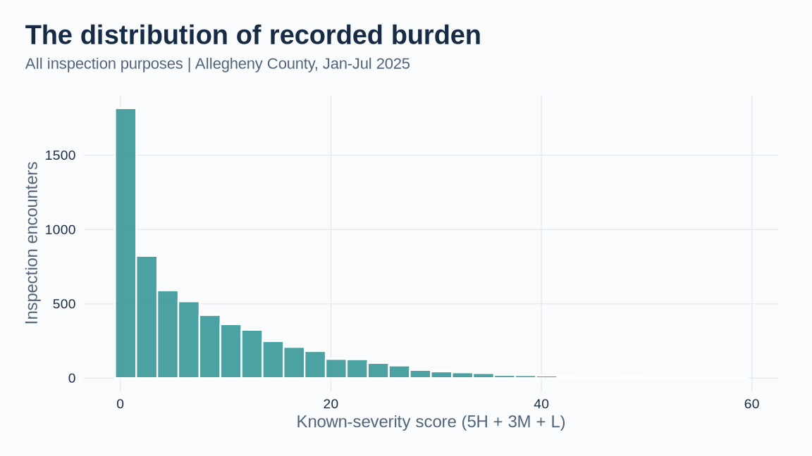
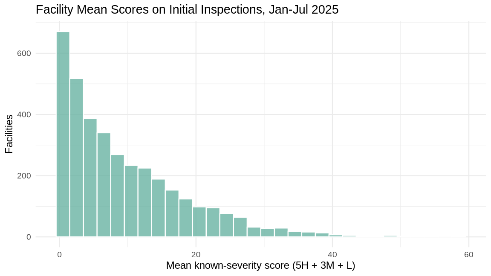
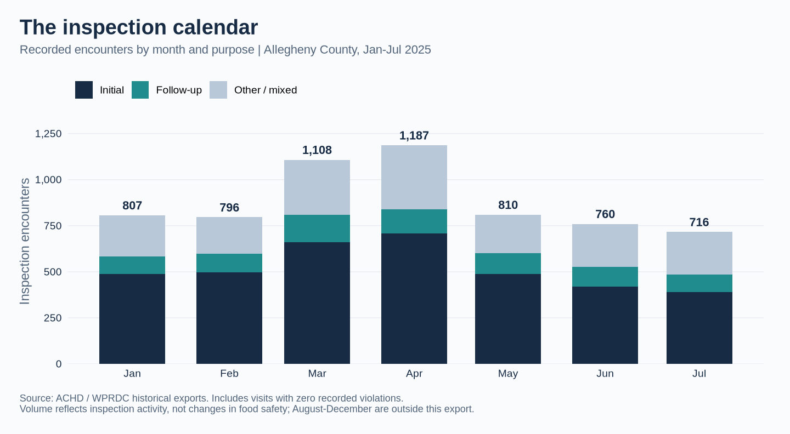
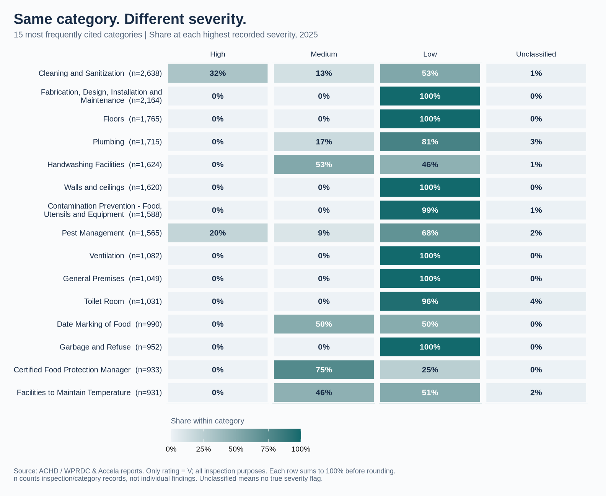
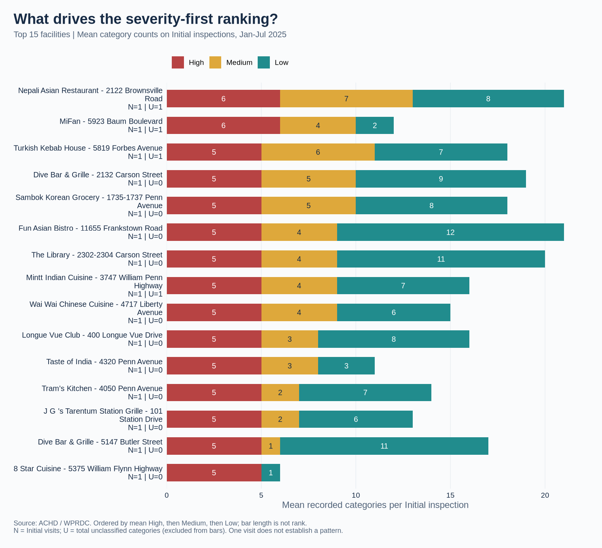
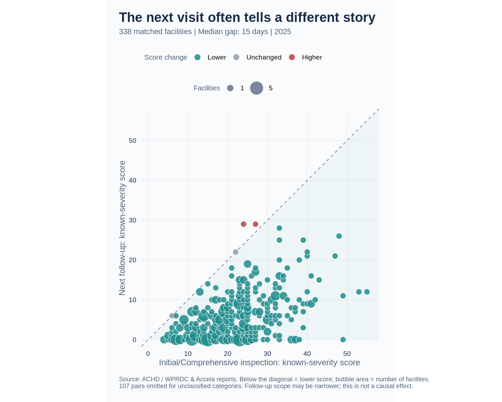

# Allegheny County Food Inspection Analysis 2025

Ranking Recorded Violations in the Available January–July Data

Mitchell Henschel

# Introduction

This analysis covers **Allegheny County**, not all of Western Pennsylvania. The local historical exports span 2014-01-02 through 2025-07-31. The 2025 results cover **2025-01-02 through 2025-07-31**, with 6,184 inspection encounters and 28,430 recorded violation-category rows. This is a partial-year analysis, not a complete 2025 ranking.

As a local data scientist, I wanted to make these public records easier to compare while preserving the severity information recorded by inspectors. This ranking is my analytical summary, not an official Health Department grade or an estimate of the probability of foodborne illness.

## What the Health Department's categories mean

The [Allegheny County Health Department (ACHD)](https://www.alleghenycounty.us/Services/Health-Department/Food-Safety/Search-Inspection-Reports) describes three severity levels:

| Severity | Meaning | Examples on ACHD's page |
|:---|:---|:---|
| High | Can directly lead to foodborne illness | Unsafe holding/cooking temperatures; improper employee handwashing |
| Medium | Can increase the chance of foodborne illness | No soap at handwashing sinks; no food probe thermometer; no Certified Food Protection Manager present |
| Low | Usually does not cause foodborne illness on its own; concerns cleanliness, safety, or maintenance | Damaged floors, poorly maintained ventilation hoods, poor lighting |

These are examples, not a fixed severity lookup for all findings in a category. The original ranking assigned floors and lighting 4 points, a missing manager 5, and thermometers 1; those assignments did not reflect the recorded severity. The revised analysis uses the CSV's **`high`, `medium`, and `low` flags for each inspection/category**, rather than guessing from `description_new`.

## Counting and ranking rules

1. **Only `rating = V` is a violation.** Other assessment rows are excluded even if severity flags remain populated. For example, the [Party Cake Shop report of February 19, 2025](https://appsrv.alleghenycounty.us/reports/rwservlet?food_rep_insp&P_ENCOUNTER=202502190003) lists eight violation categories; its CSV also has a non-violation thermometer row. The revised pipeline counts eight, not nine.
2. **Count categories, not individual findings.** Each row is an inspection/category pair; one category can describe several problems. When multiple severity flags are true, assign that category its highest recorded severity (high, then medium, then low). Thus H, M, and L below are mutually exclusive category counts and may differ from the report's counts of all checked severity boxes.
3. **Keep unclassified violations visible.** A `V` row with no true severity flag is unclassified (U), not low risk or a zero-risk finding. H + M + L + U equals the number of violation categories. In this period, 1,100 categories are unclassified across 972 encounters. Rankings based on known severities may understate those encounters.
4. **Primary ranking: H, then M, then L, descending.** More high-severity categories rank ahead of any number of lower-severity categories. This is an explicit analytical choice to prioritize severity; ACHD does not prescribe this ordering of facilities. Identical H/M/L profiles share a rank. Dates and encounter IDs only stabilize display order; a top-20 display can cut a tie.
5. **Secondary score: 5H + 3M + L.** These are analyst-selected weights, not ACHD weights or measured risk ratios. The **known-severity score** omits unclassified categories and is incomplete wherever U > 0. It measures recorded category burden, not safety. No median or quartile is labeled a “clean” or “acceptable” threshold.

## Comparison population and data quality

- Link the historical inspection and violation exports by **`encounter`**, and group facilities by **`id`**. Names and street addresses are display labels, not identifiers. Separate encounters on the same date remain separate inspections.
- Include encounters from the inspection export even when there are no matching `V` rows. There are 1,161 such encounters in this period. “Zero recorded violations” is a database result, not proof that every condition was assessed or satisfactory.
- Compare facilities primarily using the mean H/M/L profile of visits whose purpose is exactly **“Initial.”** Reinspections, complaints, new-facility visits, and mixed-purpose encounters can have different scopes. All-encounter averages remain descriptive context. Even Initial visits are not a random or fully standardized sample, and facilities with one visit have limited evidence.
- Restrict processing to the overlapping observed date range of the two exports. This guards against treating later inspections as clean when the violation feed ends earlier; it cannot prove that either export is complete within that range.
- Exclude explicit training-client names by facility ID and export the exclusion list for review. Retain legitimate names such as “Latest Scoop” and “Getgo Corporate Office & Test Kitchen.” Duplicate encounter/category rows, invalid severity flags, and unmatched inspection metadata stop processing instead of silently changing rankings.

The [WPRDC dataset](https://data.wprdc.org/dataset/allegheny-county-restaurant-food-facility-inspection-violations) provides both historical exports. ACHD says it changed software on **August 11, 2025**; later reports are available through [Citizens Access](https://aca-prod.accela.com/ALLEGHENYCO/Cap/CapHome.aspx?module=EnvHealth&TabName=Home). The local violation export ends before that transition. Historical report links and inspection placards describe those visits, not a facility's current status.

# Stats for Nerds

Distribution of known-severity scores for all recorded inspection encounters in the available 2025 period, including zero-recorded-violation visits:

<!-- -->

Table: Known-severity score summary (all purposes)

|Statistic | Score|
|:---------|-----:|
|Min       |  0.00|
|Q1        |  1.00|
|Median    |  5.00|
|Mean      |  7.96|
|Q3        | 12.00|
|Max       | 59.00|

For facility comparisons, use only Initial inspections and retain zero-recorded-violation visits in the denominator. This distribution gives each facility one observation: its mean known-severity score over its Initial inspections in the available period.

<!-- -->

Table: Facility mean score summary (Initial inspections only)

|Statistic | Score|
|:---------|-----:|
|Min       |  0.00|
|Q1        |  2.00|
|Median    |  7.00|
|Mean      |  9.39|
|Q3        | 14.00|
|Max       | 59.00|

## Sensitivity to the ranking method

The severity-first and 5/3/1 weighted top-20 inspection lists share **12 of 20** encounters. Changing the weights to 3/2/1 retains **18 of 20** encounters from the 5/3/1 list. These are descriptive sensitivity checks with deterministic tie-breaking, not statistical confidence measures. The main severity-first ranking does not depend on numerical weights.

# A Visual Tour of the Findings

## Inspection activity and scope

Inspection volume and purpose provide context for the rankings. The chart counts every recorded encounter, including visits with no recorded violations. “Follow-up” includes the exact purposes Reinspection and Partial ReInspection; mixed-purpose visits are grouped with other visits. These monthly counts describe activity, not a trend in restaurant safety.

## Why category names alone cannot determine severity

Each row below shows the severity mix within one of the 15 most frequently cited categories. A darker cell means a larger share of that category's violation records, not a more dangerous category. The variation is why this analysis uses the inspector's recorded flags instead of assigning every occurrence of a category the same severity.

## The composition behind the ranking

The bars below show the mean number of categories at each severity for the top 15 facilities in the Initial-only ranking. Facilities are ordered by their severity profile, not by total bar length. The annotations retain the inspection denominator and the number of unclassified categories so the limits of each comparison remain visible.

## What happens at the next recorded follow-up?

Match an Initial visit to the very next recorded encounter for the same facility only when that encounter is a Reinspection or Partial ReInspection on a later date. Keep the earliest eligible pair per facility within the available 2025 period, then exclude pairs with unclassified categories at either visit. This is chronological matching, not a verified administrative link between reports. Same-day pairs are excluded because the analysis does not use visit times.

Below the diagonal, the follow-up score is lower than the Initial score. Bubble area represents the number of facilities at the same coordinates. These facilities are a selected group that received follow-up visits; changes can reflect both corrections and narrower follow-up scope. Facilities without an eligible observed follow-up, including those near the July cutoff, do not appear.

# 2025 Rankings: Available January–July Period

Click a facility name for the linked historical report. **H/M/L** are category counts at the highest recorded severity; **U** is the number of unclassified categories. The tables describe recorded conditions during this period, not current operating conditions.

## Inspections ranked by recorded severity

Table: Top 20 inspection encounters by H, then M, then L

|Facility                                                      | Rank|Date       |Purpose            |  H|  M|  L|  U|
|:-------------------------------------------------------------|----:|:----------|:------------------|--:|--:|--:|--:|
|[Enson Market - 7511 Thomas Boulevard, Pittsburgh](https://appsrv.alleghenycounty.us/reports/rwservlet?food_rep_insp&P_ENCOUNTER=202507100056)|    1|2025-07-10 |Reinspection       |  7|  6|  6|  1|
|[Nepali Asian Restaurant - 2122 Brownsville Road, Pittsburgh](https://appsrv.alleghenycounty.us/reports/rwservlet?food_rep_insp&P_ENCOUNTER=202501090031)|    2|2025-01-09 |Initial            |  6|  7|  8|  1|
|[MiFan - 5923 Baum Boulevard, Pittsburgh](https://appsrv.alleghenycounty.us/reports/rwservlet?food_rep_insp&P_ENCOUNTER=202504170010)|    3|2025-04-17 |Initial            |  6|  4|  2|  1|
|[How Lee - 5888 Forbes Avenue, Pittsburgh](https://appsrv.alleghenycounty.us/reports/rwservlet?food_rep_insp&P_ENCOUNTER=202503170111)|    4|2025-03-17 |Initial, Complaint |  6|  3|  9|  0|
|[Rose Tea Cafe Express - 414 Craig Street, Pittsburgh](https://appsrv.alleghenycounty.us/reports/rwservlet?food_rep_insp&P_ENCOUNTER=202501020012)|    5|2025-01-02 |Initial            |  6|  3|  8|  1|
|[The Mintt - 3033 Banksville Road, Pittsburgh](https://appsrv.alleghenycounty.us/reports/rwservlet?food_rep_insp&P_ENCOUNTER=202504210035)|    6|2025-04-21 |Initial, Complaint |  5|  6| 10|  0|
|[Turkish Kebab House - 5819 Forbes Avenue, Pittsburgh](https://appsrv.alleghenycounty.us/reports/rwservlet?food_rep_insp&P_ENCOUNTER=202506050027)|    7|2025-06-05 |Initial            |  5|  6|  7|  1|
|[Dive Bar & Grille - 2132 Carson Street, Pittsburgh](https://appsrv.alleghenycounty.us/reports/rwservlet?food_rep_insp&P_ENCOUNTER=202506130009)|    8|2025-06-13 |Initial            |  5|  5|  9|  0|
|[Sambok Korean Grocery - 1735-1737 Penn Avenue, Pittsburgh](https://appsrv.alleghenycounty.us/reports/rwservlet?food_rep_insp&P_ENCOUNTER=202501030016)|    9|2025-01-03 |Initial            |  5|  5|  8|  0|
|[Fun Asian Bistro - 11655 Frankstown Road, Pittsburgh](https://appsrv.alleghenycounty.us/reports/rwservlet?food_rep_insp&P_ENCOUNTER=202507010031)|   10|2025-07-01 |Initial            |  5|  4| 12|  0|
|[The Library - 2302-2304 Carson Street, Pittsburgh](https://appsrv.alleghenycounty.us/reports/rwservlet?food_rep_insp&P_ENCOUNTER=202503180056)|   11|2025-03-18 |Initial            |  5|  4| 11|  0|
|[The Fireside Inn - 4214 Steubenville Pike, Pittsburgh](https://appsrv.alleghenycounty.us/reports/rwservlet?food_rep_insp&P_ENCOUNTER=202503190039)|   12|2025-03-19 |Initial, Complaint |  5|  4|  7|  1|
|[Mintt Indian Cuisine - 3747 William Penn Highway, Monroeville](https://appsrv.alleghenycounty.us/reports/rwservlet?food_rep_insp&P_ENCOUNTER=202503060024)|   12|2025-03-06 |Initial            |  5|  4|  7|  1|
|[Wai Wai Chinese Cuisine - 4717  Liberty  Avenue, Pittsburgh](https://appsrv.alleghenycounty.us/reports/rwservlet?food_rep_insp&P_ENCOUNTER=202504230042)|   14|2025-04-23 |Initial            |  5|  4|  6|  0|
|[Longue Vue Club - 400 Longue Vue  Drive, Verona](https://appsrv.alleghenycounty.us/reports/rwservlet?food_rep_insp&P_ENCOUNTER=202507230023)|   15|2025-07-23 |Initial            |  5|  3|  8|  0|
|[Everyday Noodles - 5875 Forbes  Avenue, Pittsburgh](https://appsrv.alleghenycounty.us/reports/rwservlet?food_rep_insp&P_ENCOUNTER=202506180024)|   16|2025-06-18 |Initial, Complaint |  5|  3|  7|  0|
|[Taste of India - 4320 Penn Avenue, Pittsburgh](https://appsrv.alleghenycounty.us/reports/rwservlet?food_rep_insp&P_ENCOUNTER=202503200033)|   17|2025-03-20 |Initial            |  5|  3|  3|  0|
|[Caravan - 10 Smithfield Street, Pittsburgh](https://appsrv.alleghenycounty.us/reports/rwservlet?food_rep_insp&P_ENCOUNTER=202507100050)|   18|2025-07-10 |Complaint          |  5|  3|  0|  1|
|[Tram's Kitchen - 4050 Penn Avenue, Pittsburgh](https://appsrv.alleghenycounty.us/reports/rwservlet?food_rep_insp&P_ENCOUNTER=202502190031)|   19|2025-02-19 |Initial            |  5|  2|  7|  0|
|[J G 's Tarentum Station Grille - 101 Station Drive, Tarentum](https://appsrv.alleghenycounty.us/reports/rwservlet?food_rep_insp&P_ENCOUNTER=202507140037)|   20|2025-07-14 |Initial            |  5|  2|  6|  0|

## Secondary view: weighted category burden

This list allows several lower-severity categories to outweigh a higher-severity category. It answers a different question from the main ranking. The score is incomplete when U > 0.

Table: Top 20 encounters by known-severity score (5H + 3M + L)

|Facility                                                                            |Date       |Purpose               | Score|  H|  M|  L|  U|
|:-----------------------------------------------------------------------------------|:----------|:---------------------|-----:|--:|--:|--:|--:|
|[Enson Market - 7511 Thomas Boulevard, Pittsburgh](https://appsrv.alleghenycounty.us/reports/rwservlet?food_rep_insp&P_ENCOUNTER=202507100056)|2025-07-10 |Reinspection          |    59|  7|  6|  6|  1|
|[Nepali Asian Restaurant - 2122 Brownsville Road, Pittsburgh](https://appsrv.alleghenycounty.us/reports/rwservlet?food_rep_insp&P_ENCOUNTER=202501090031)|2025-01-09 |Initial               |    59|  6|  7|  8|  1|
|[Diners 2+1 - 1722 Murray Avenue, Pittsburgh](https://appsrv.alleghenycounty.us/reports/rwservlet?food_rep_insp&P_ENCOUNTER=202503180044)|2025-03-18 |Initial               |    55|  4|  8| 11|  0|
|[Lucca Ristorante & Wine Bar - 317 Craig  Street, Pittsburgh](https://appsrv.alleghenycounty.us/reports/rwservlet?food_rep_insp&P_ENCOUNTER=202507010017)|2025-07-01 |Initial               |    53|  4|  7| 12|  0|
|[The Mintt - 3033 Banksville Road, Pittsburgh](https://appsrv.alleghenycounty.us/reports/rwservlet?food_rep_insp&P_ENCOUNTER=202504210035)|2025-04-21 |Initial, Complaint    |    53|  5|  6| 10|  0|
|[Shannopin Country Club Restaurant - 1 Windmere Rd, Pittsburgh](https://appsrv.alleghenycounty.us/reports/rwservlet?food_rep_insp&P_ENCOUNTER=202507150047)|2025-07-15 |Initial               |    51|  4|  7| 10|  1|
|[Turkish Kebab House - 5819 Forbes Avenue, Pittsburgh](https://appsrv.alleghenycounty.us/reports/rwservlet?food_rep_insp&P_ENCOUNTER=202506050027)|2025-06-05 |Initial               |    50|  5|  6|  7|  1|
|[Zen Asian Diner - 5100 Butler Street, Pittsburgh](https://appsrv.alleghenycounty.us/reports/rwservlet?food_rep_insp&P_ENCOUNTER=202507140064)|2025-07-14 |Initial               |    49|  4|  7|  8|  0|
|[Fun Asian Bistro - 11655 Frankstown Road, Pittsburgh](https://appsrv.alleghenycounty.us/reports/rwservlet?food_rep_insp&P_ENCOUNTER=202507010031)|2025-07-01 |Initial               |    49|  5|  4| 12|  0|
|[Dive Bar & Grille - 2132 Carson Street, Pittsburgh](https://appsrv.alleghenycounty.us/reports/rwservlet?food_rep_insp&P_ENCOUNTER=202506130009)|2025-06-13 |Initial               |    49|  5|  5|  9|  0|
|[The Library - 2302-2304 Carson Street, Pittsburgh](https://appsrv.alleghenycounty.us/reports/rwservlet?food_rep_insp&P_ENCOUNTER=202503180056)|2025-03-18 |Initial               |    48|  5|  4| 11|  0|
|[How Lee - 5888 Forbes Avenue, Pittsburgh](https://appsrv.alleghenycounty.us/reports/rwservlet?food_rep_insp&P_ENCOUNTER=202503170111)|2025-03-17 |Initial, Complaint    |    48|  6|  3|  9|  0|
|[Sambok Korean Grocery - 1735-1737 Penn Avenue, Pittsburgh](https://appsrv.alleghenycounty.us/reports/rwservlet?food_rep_insp&P_ENCOUNTER=202501030016)|2025-01-03 |Initial               |    48|  5|  5|  8|  0|
|[Hastina Royal Indian Cuisine - 1120 Park Manor Boulevard, Pittsburgh](https://appsrv.alleghenycounty.us/reports/rwservlet?food_rep_insp&P_ENCOUNTER=202506110018)|2025-06-11 |Initial, New Facility |    47|  3|  7| 11|  1|
|[Yue Bai Wei - 5874 Forbes Avenue, Pittsburgh](https://appsrv.alleghenycounty.us/reports/rwservlet?food_rep_insp&P_ENCOUNTER=202505050047)|2025-05-05 |Initial               |    47|  3|  8|  8|  0|
|[Rose Tea Cafe Express - 414 Craig Street, Pittsburgh](https://appsrv.alleghenycounty.us/reports/rwservlet?food_rep_insp&P_ENCOUNTER=202501020012)|2025-01-02 |Initial               |    47|  6|  3|  8|  1|
|[China Buffet King - 2249 Noblestown Road, Pittsburgh](https://appsrv.alleghenycounty.us/reports/rwservlet?food_rep_insp&P_ENCOUNTER=202505080030)|2025-05-08 |Initial, Complaint    |    46|  4|  6|  8|  0|
|[Montour Heights Country Club Restaurant - 1491 Coraopolis Heights  Road, Coraopolis](https://appsrv.alleghenycounty.us/reports/rwservlet?food_rep_insp&P_ENCOUNTER=202506170033)|2025-06-17 |Initial, Complaint    |    44|  4|  5|  9|  0|
|[MiFan - 5923 Baum Boulevard, Pittsburgh](https://appsrv.alleghenycounty.us/reports/rwservlet?food_rep_insp&P_ENCOUNTER=202504170010)|2025-04-17 |Initial               |    44|  6|  4|  2|  1|
|[The Fireside Inn - 4214 Steubenville Pike, Pittsburgh](https://appsrv.alleghenycounty.us/reports/rwservlet?food_rep_insp&P_ENCOUNTER=202503190039)|2025-03-19 |Initial, Complaint    |    44|  5|  4|  7|  1|

## Facilities ranked using Initial inspections

Order facilities by mean H, then mean M, then mean L across Initial inspections only. **N** is the number of those inspections; **U** is their total unclassified category count. A high mean based on N = 1 does not establish a pattern of repeated problems. Links go to each facility's latest recorded encounter in the period, which may be a reinspection rather than an Initial visit.

Table: Top 20 facilities by mean Initial-inspection severity profile

|Facility                                                            | Rank|  N| Mean H| Mean M| Mean L|  U|
|:-------------------------------------------------------------------|----:|--:|------:|------:|------:|--:|
|[Nepali Asian Restaurant - 2122 Brownsville Road, Pittsburgh](https://appsrv.alleghenycounty.us/reports/rwservlet?food_rep_insp&P_ENCOUNTER=202502190018)|    1|  1|      6|      7|      8|  1|
|[MiFan - 5923 Baum Boulevard, Pittsburgh](https://appsrv.alleghenycounty.us/reports/rwservlet?food_rep_insp&P_ENCOUNTER=202504290057)|    2|  1|      6|      4|      2|  1|
|[Turkish Kebab House - 5819 Forbes Avenue, Pittsburgh](https://appsrv.alleghenycounty.us/reports/rwservlet?food_rep_insp&P_ENCOUNTER=202507090039)|    3|  1|      5|      6|      7|  1|
|[Dive Bar & Grille - 2132 Carson Street, Pittsburgh](https://appsrv.alleghenycounty.us/reports/rwservlet?food_rep_insp&P_ENCOUNTER=202507080031)|    4|  1|      5|      5|      9|  0|
|[Sambok Korean Grocery - 1735-1737 Penn Avenue, Pittsburgh](https://appsrv.alleghenycounty.us/reports/rwservlet?food_rep_insp&P_ENCOUNTER=202501030016)|    5|  1|      5|      5|      8|  0|
|[Fun Asian Bistro - 11655 Frankstown Road, Pittsburgh](https://appsrv.alleghenycounty.us/reports/rwservlet?food_rep_insp&P_ENCOUNTER=202507080023)|    6|  1|      5|      4|     12|  0|
|[The Library - 2302-2304 Carson Street, Pittsburgh](https://appsrv.alleghenycounty.us/reports/rwservlet?food_rep_insp&P_ENCOUNTER=202504210045)|    7|  1|      5|      4|     11|  0|
|[Mintt Indian Cuisine - 3747 William Penn Highway, Monroeville](https://appsrv.alleghenycounty.us/reports/rwservlet?food_rep_insp&P_ENCOUNTER=202503200053)|    8|  1|      5|      4|      7|  1|
|[Wai Wai Chinese Cuisine - 4717  Liberty  Avenue, Pittsburgh](https://appsrv.alleghenycounty.us/reports/rwservlet?food_rep_insp&P_ENCOUNTER=202505080029)|    9|  1|      5|      4|      6|  0|
|[Longue Vue Club - 400 Longue Vue  Drive, Verona](https://appsrv.alleghenycounty.us/reports/rwservlet?food_rep_insp&P_ENCOUNTER=202507230023)|   10|  1|      5|      3|      8|  0|
|[Taste of India - 4320 Penn Avenue, Pittsburgh](https://appsrv.alleghenycounty.us/reports/rwservlet?food_rep_insp&P_ENCOUNTER=202503210025)|   11|  1|      5|      3|      3|  0|
|[Tram's Kitchen - 4050 Penn Avenue, Pittsburgh](https://appsrv.alleghenycounty.us/reports/rwservlet?food_rep_insp&P_ENCOUNTER=202507150046)|   12|  1|      5|      2|      7|  0|
|[J G 's Tarentum Station Grille - 101 Station Drive, Tarentum](https://appsrv.alleghenycounty.us/reports/rwservlet?food_rep_insp&P_ENCOUNTER=202507210053)|   13|  1|      5|      2|      6|  0|
|[Dive Bar & Grille - 5147 Butler Street, Pittsburgh](https://appsrv.alleghenycounty.us/reports/rwservlet?food_rep_insp&P_ENCOUNTER=202507140048)|   14|  1|      5|      1|     11|  0|
|[8 Star Cuisine - 5375 William Flynn Highway, Gibsonia](https://appsrv.alleghenycounty.us/reports/rwservlet?food_rep_insp&P_ENCOUNTER=202506040027)|   15|  1|      5|      0|      1|  0|
|[Diners 2+1 - 1722 Murray Avenue, Pittsburgh](https://appsrv.alleghenycounty.us/reports/rwservlet?food_rep_insp&P_ENCOUNTER=202504070051)|   16|  1|      4|      8|     11|  0|
|[Lucca Ristorante & Wine Bar - 317 Craig  Street, Pittsburgh](https://appsrv.alleghenycounty.us/reports/rwservlet?food_rep_insp&P_ENCOUNTER=202507100002)|   17|  1|      4|      7|     12|  0|
|[Shannopin Country Club Restaurant - 1 Windmere Rd, Pittsburgh](https://appsrv.alleghenycounty.us/reports/rwservlet?food_rep_insp&P_ENCOUNTER=202507150047)|   18|  1|      4|      7|     10|  1|
|[Zen Asian Diner - 5100 Butler Street, Pittsburgh](https://appsrv.alleghenycounty.us/reports/rwservlet?food_rep_insp&P_ENCOUNTER=202507140064)|   19|  1|      4|      7|      8|  0|
|[Osaka Sushi & Chinese Restaurant - 2101 Greentree  Road, Pittsburgh](https://appsrv.alleghenycounty.us/reports/rwservlet?food_rep_insp&P_ENCOUNTER=202507180015)|   20|  1|      4|      5|      7|  0|

## Follow-up context for those facilities

For the same facilities, **N** counts all encounter purposes and **Mean** is the all-encounter mean known-severity score, including zero-recorded-violation visits. **Latest** is the score for the linked encounter; **U** is its unclassified category count. The mean also omits unclassified categories on earlier visits; their totals are retained in the CSV. A lower follow-up score can reflect corrections or a narrower inspection scope, so it does not prove that all previous problems were resolved.

Table: All-encounter and latest-visit context for the facilities above

|Facility                                                            |  N|  Mean|Date       |Purpose              | Latest|  U|
|:-------------------------------------------------------------------|--:|-----:|:----------|:--------------------|------:|--:|
|[Nepali Asian Restaurant - 2122 Brownsville Road, Pittsburgh](https://appsrv.alleghenycounty.us/reports/rwservlet?food_rep_insp&P_ENCOUNTER=202502190018)|  4| 20.75|2025-02-19 |Reinspection         |     14|  0|
|[MiFan - 5923 Baum Boulevard, Pittsburgh](https://appsrv.alleghenycounty.us/reports/rwservlet?food_rep_insp&P_ENCOUNTER=202504290057)|  2| 23.00|2025-04-29 |Reinspection         |      2|  0|
|[Turkish Kebab House - 5819 Forbes Avenue, Pittsburgh](https://appsrv.alleghenycounty.us/reports/rwservlet?food_rep_insp&P_ENCOUNTER=202507090039)|  6| 13.67|2025-07-09 |Partial ReInspection |      0|  0|
|[Dive Bar & Grille - 2132 Carson Street, Pittsburgh](https://appsrv.alleghenycounty.us/reports/rwservlet?food_rep_insp&P_ENCOUNTER=202507080031)|  2| 30.00|2025-07-08 |Reinspection         |     11|  0|
|[Sambok Korean Grocery - 1735-1737 Penn Avenue, Pittsburgh](https://appsrv.alleghenycounty.us/reports/rwservlet?food_rep_insp&P_ENCOUNTER=202501030016)|  1| 48.00|2025-01-03 |Initial              |     48|  0|
|[Fun Asian Bistro - 11655 Frankstown Road, Pittsburgh](https://appsrv.alleghenycounty.us/reports/rwservlet?food_rep_insp&P_ENCOUNTER=202507080023)|  2| 24.50|2025-07-08 |Partial ReInspection |      0|  0|
|[The Library - 2302-2304 Carson Street, Pittsburgh](https://appsrv.alleghenycounty.us/reports/rwservlet?food_rep_insp&P_ENCOUNTER=202504210045)|  2| 37.00|2025-04-21 |Reinspection         |     26|  0|
|[Mintt Indian Cuisine - 3747 William Penn Highway, Monroeville](https://appsrv.alleghenycounty.us/reports/rwservlet?food_rep_insp&P_ENCOUNTER=202503200053)|  2| 30.00|2025-03-20 |Reinspection         |     16|  1|
|[Wai Wai Chinese Cuisine - 4717  Liberty  Avenue, Pittsburgh](https://appsrv.alleghenycounty.us/reports/rwservlet?food_rep_insp&P_ENCOUNTER=202505080029)|  2| 29.00|2025-05-08 |Reinspection         |     15|  0|
|[Longue Vue Club - 400 Longue Vue  Drive, Verona](https://appsrv.alleghenycounty.us/reports/rwservlet?food_rep_insp&P_ENCOUNTER=202507230023)|  1| 42.00|2025-07-23 |Initial              |     42|  0|
|[Taste of India - 4320 Penn Avenue, Pittsburgh](https://appsrv.alleghenycounty.us/reports/rwservlet?food_rep_insp&P_ENCOUNTER=202503210025)|  2| 18.50|2025-03-21 |Partial ReInspection |      0|  0|
|[Tram's Kitchen - 4050 Penn Avenue, Pittsburgh](https://appsrv.alleghenycounty.us/reports/rwservlet?food_rep_insp&P_ENCOUNTER=202507150046)|  3| 12.67|2025-07-15 |Service Request      |      0|  0|
|[J G 's Tarentum Station Grille - 101 Station Drive, Tarentum](https://appsrv.alleghenycounty.us/reports/rwservlet?food_rep_insp&P_ENCOUNTER=202507210053)|  2| 22.50|2025-07-21 |Partial ReInspection |      8|  0|
|[Dive Bar & Grille - 5147 Butler Street, Pittsburgh](https://appsrv.alleghenycounty.us/reports/rwservlet?food_rep_insp&P_ENCOUNTER=202507140048)|  2| 21.00|2025-07-14 |Reinspection         |      3|  0|
|[8 Star Cuisine - 5375 William Flynn Highway, Gibsonia](https://appsrv.alleghenycounty.us/reports/rwservlet?food_rep_insp&P_ENCOUNTER=202506040027)|  2| 14.50|2025-06-04 |Initial              |     26|  0|
|[Diners 2+1 - 1722 Murray Avenue, Pittsburgh](https://appsrv.alleghenycounty.us/reports/rwservlet?food_rep_insp&P_ENCOUNTER=202504070051)|  5| 24.00|2025-04-07 |Reinspection         |     11|  0|
|[Lucca Ristorante & Wine Bar - 317 Craig  Street, Pittsburgh](https://appsrv.alleghenycounty.us/reports/rwservlet?food_rep_insp&P_ENCOUNTER=202507100002)|  2| 32.50|2025-07-10 |Reinspection         |     12|  0|
|[Shannopin Country Club Restaurant - 1 Windmere Rd, Pittsburgh](https://appsrv.alleghenycounty.us/reports/rwservlet?food_rep_insp&P_ENCOUNTER=202507150047)|  1| 51.00|2025-07-15 |Initial              |     51|  1|
|[Zen Asian Diner - 5100 Butler Street, Pittsburgh](https://appsrv.alleghenycounty.us/reports/rwservlet?food_rep_insp&P_ENCOUNTER=202507140064)|  1| 49.00|2025-07-14 |Initial              |     49|  0|
|[Osaka Sushi & Chinese Restaurant - 2101 Greentree  Road, Pittsburgh](https://appsrv.alleghenycounty.us/reports/rwservlet?food_rep_insp&P_ENCOUNTER=202507180015)|  2| 26.00|2025-07-07 |Reinspection         |     10|  0|

# Discussion

The category summaries cannot convey all the detail in an inspector's narrative. Here are selected excerpts from the historical reports, including corrections made during the visits:

**[Lucca Ristorante & Wine Bar, Craig St, 07/01/2025](https://appsrv.alleghenycounty.us/reports/rwservlet?food_rep_insp&P_ENCOUNTER=202507010017):**

- There are bottles of liquor stored beneath and contaminated by an unknown water source from
the active ceiling leak behind the bar. The operator voluntarily moved the affected bottles to a safe
storage location and discontinued service behind the bar.

**[The Library, Carson St, 03/18/2025](https://appsrv.alleghenycounty.us/reports/rwservlet?food_rep_insp&P_ENCOUNTER=202503180056):**

-  Numerous rodent droppings [in 6 areas]... Nesting material was identified [in 4 areas]... Loose bait found in kitchen and basement.

- Black mold-like substance and a pink biofilm was identified on the ice machine deflector plate
and surrounding areas.

- Oyster and chicken breading preparation cooler interior has excessive amounts of old food debris.

- It was discovered that the dish machine is not functioning properly and is failing to sanitize
effectively. The chlorine readout measured at 0.00 PPM. Owner initiated a phone call for repairs.

**[Zen Asian Diner, Butler St, 07/14/2025](https://appsrv.alleghenycounty.us/reports/rwservlet?food_rep_insp&P_ENCOUNTER=202507140064)**

- In basement, there is a decayed corpse of an animal, about the size of a possum or large rat.
Unable to determine the type of animal during inspection.

- Too many flies to count found throughout all food preparation areas of entire facility.

- The garage that holds the dumpster and grease receptacle has a door that leads directly into the
food preparation room and that door does not seal.

*REPEAT VIOLATIONS*

**[Fun Asian Bistro, Frankstown Rd, 07/01/2025](https://appsrv.alleghenycounty.us/reports/rwservlet?food_rep_insp&P_ENCOUNTER=202507010031)**

- Did not observe any employee handwashing during inspection.

- Employee observed eating on cookline.

- Temperature/Time Controlled for Safety (TCS) foods such as tofu, beef, chicken, cooked noodles,
and cooked rice were found between 45-55F in the two-door and three-door prep coolers. All foods
discarded.

- Cooked chicken by grill had a temperature of 75F. Owner says it was cooked this morning.
Discarded during inspection. *REPEAT VIOLATION*

**[Hastina Royal Indian Cuisine, Park Manor Boulevard, 06/11/2025](https://appsrv.alleghenycounty.us/reports/rwservlet?food_rep_insp&P_ENCOUNTER=202506110018)**

- Facility is open and operating without a valid health permit.

- Facility failed to submit plans for a change of ownership and transfer of a sister LLC.

- Consumer alert administered during inspection due to several high and medium risk violations.

**[The Mintt, Banksville Rd, 04/21/2025](https://appsrv.alleghenycounty.us/reports/rwservlet?food_rep_insp&P_ENCOUNTER=202504210035)**

- In the walk-in cooler, a container of raw lamb was observed stored behind a loosely covered bowl
of dough. Blood was observed to have dripped onto the plastic wrap covering a bowl of pudding.

---

Health inspections are a snapshot of how a food facility is operating at a specific point in time, not a permanent verdict. Severity, inspection scope, and follow-up findings matter more than a single league-table position. Read the full report and check recent inspections before drawing conclusions about a facility today.

Questions and suggestions on my methodology are welcome. Thanks for reading!

[Source code](https://github.com/Elkip/West-PA-Health-Inspection-Analysis/tree/master)

[Original Google Sheets export (may use the earlier methodology)](https://docs.google.com/spreadsheets/d/14fzHPMQwi2yXgINs_aTp1Vy-1ni_tRFI3wfmFX-IPXc)

# Reproducing the Analysis

Use R 4.1 or later with `dplyr` (1.1.0 or later), `tidyr`, `ggplot2`, `stringr`, `scales`, and `knitr`. Packages must be built for a compatible version of R. From the repository root:

1. Save the [historical violation export](https://data.wprdc.org/datastore/dump/1a1329e2-418c-4bd3-af2c-cc334e7559af) as `data/violations.csv` and the matching [historical inspection export](https://data.wprdc.org/datastore/dump/4ea730d8-2bf9-4783-b0a5-b41ed687097e) as `data/inspections.csv`. Both resources are labeled 2014–2025 on WPRDC. The newer inspection feed uses a different schema.
2. Run `Rscript clean_inspections.r` to generate the summaries in `out/`.
3. Run `Rscript tests/test_inspection_analysis.R` to check scoring and aggregation, including two comparisons with original inspection PDFs when the local exports are available. Run `Rscript tests/test_followup_matching.R` to check the follow-up chart's matching rules.
4. Run `Rscript render_readme.r` to regenerate `README.md` and its plots from this document. For a PDF, install Quarto and a TeX distribution and run `quarto render 2025_hall_of_shame.qmd --to pdf`.

Generated files:

- `out/violations_by_inspection.csv`: all encounters in the shared export window, purpose, severity counts, unclassified counts, known-severity score, and `SCORE_COMPLETE` (whether every recorded violation category has a severity).
- `out/violations_by_year.csv`: facility/year summaries, Initial-only and all-encounter means, denominators, and latest-report context within each year. The 2025 rows cover only the available period.
- `out/category_severity_audit.csv`: recorded severity distribution by category and year across the shared historical window; the visualizations use only 2025.
- `out/coverage.csv`: date bounds and record counts after training-client exclusions.
- `out/excluded_training_facilities.csv`: excluded facility identifiers and names.
